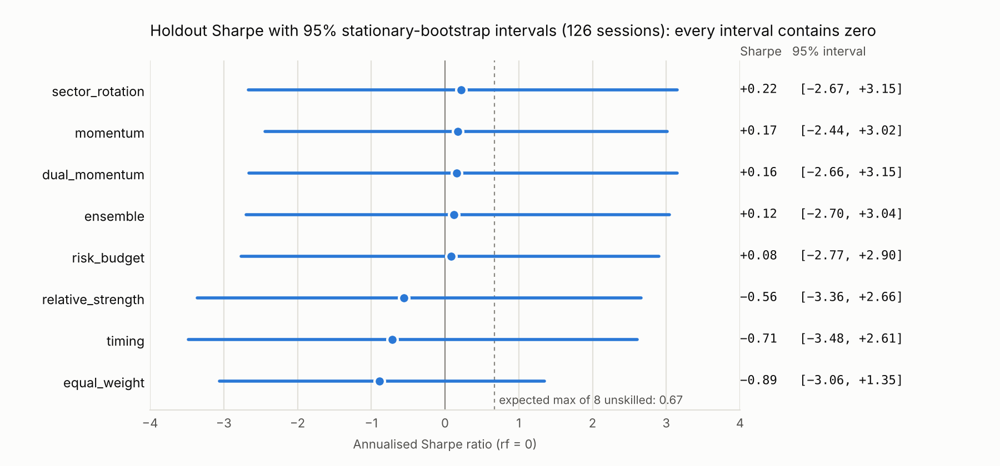
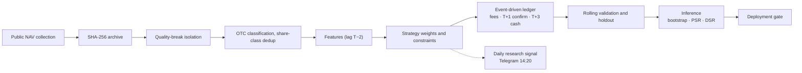

<div align="center">

<h1>FuGuoCup Quant</h1>

<p><b>Sector momentum in Fullgoal OTC funds: an out-of-sample test net of subscription/redemption costs and settlement lags</b></p>

<p>
  <a href="https://github.com/stevia7896/FuGuoCup-quantsys/actions/workflows/ci.yml"></a>
  
  
  
  
</p>

<p>Personal research project · <a href="README.md">中文</a></p>

<p><a href="#summary">Summary</a> · <a href="#method">Method</a> · <a href="#validation-design">Validation</a> · <a href="#results">Results</a> · <a href="#statistical-inference">Inference</a> · <a href="#engineering">Engineering</a> · <a href="#reproduce">Reproduce</a></p>

</div>

> [!NOTE]
> **Bottom line:** None of the 9 pre-specified strategies shows a stable out-of-sample edge after fees. `sector_rotation`, which drives the live signal, is positive in only 3 of 8 rolling folds and returns +1.23% in the holdout — after first rising to +26.2% and then drawing down 20.3%. Costs are the same order of magnitude as returns. The more durable output is the research infrastructure: point-in-time data-quality isolation, an explicit subscription/redemption ledger, and results reproducible by hash.

<div align="center">

| Pre-specified strategies | Tradeable funds | Out-of-sample periods | Passed deployment gate | Best DSR |
|:---:|:---:|:---:|:---:|:---:|
| **9** | **500** | **8 rolling + 1 holdout** | **0** | **0.38** |

</div>

## Summary

| | |
|---|---|
| Question | Can cross-sectional sector momentum with a trend filter produce a stable risk-adjusted return in Fullgoal OTC funds after subscription/redemption fees, T+1 confirmation, T+3 settlement and purchase limits? |
| Sample | 2021-01-04 → 2026-10-16; 500 tradeable funds in the backtest (from 917 catalog codes) |
| Validation | Fixed parameters, no search; 252-day initial train → 8 × 126-day rolling folds → 126-day holdout |
| Conclusion | Sector momentum is not a stable alpha here. Every holdout Sharpe has a 95% bootstrap interval that straddles zero, and no deflated Sharpe exceeds 0.38. Rolling and holdout signs disagree for most strategies; momentum-type strategies pay fees of 2.7%–3.5% of initial capital in the holdout |
| Status | Research mode. No strategy passes the deployment gate; the live signal is a forward paper record only |

All numbers come from [`sample_results/2026-10-16/`](sample_results/2026-10-16/) (`model_hash ad4a7a6`, `config_hash 0b02a25`, snapshot `sha256 191bb947`). Re-running on the same snapshot reproduces them bit for bit.

<picture>
  <source media="(prefers-color-scheme: dark)" srcset="docs/figures/intervals-dark.png">
  
</picture>

<sub>Holdout Sharpe ratio per strategy with its 95% bootstrap interval; the dashed line is the expected maximum Sharpe among 8 unskilled strategies. Method in <a href="#statistical-inference">Statistical inference</a>.</sub>

## Hypotheses

| Hypothesis | Test | Result |
|---|---|---|
| H1: 20-day momentum persists at the sector level | Top-2 sectors by average `mom20`, fund selection within sector | **Not supported.** `sector_rotation` is positive in 3 of 8 folds, fold returns range −16.12% to +23.99%; compounded rolling return −4.38% |
| H2: Trend filters and risk budgeting contain drawdowns | `timing` breadth gate; `risk_budget` correlation screen + inverse vol + 12% vol target | **Partly supported.** `risk_budget` holdout drawdown 10.44% vs 20%–28% for momentum strategies, but its rolling return is −10.60% |
| H3: Fees and settlement lags materially erode the signal | Explicit subscription fee, FIFO redemption tiers, minimum holding, T+1/T+3 | **Supported.** Momentum strategies turn over 7.9–11.2× in the holdout and pay ¥5,332–7,049 in fees, comparable to holdout returns |

## Data

| Stage | Count | Notes |
|---|---:|---|
| Fullgoal catalog codes | 917 | Discovered from the company page; manager ID verified per fund |
| OTC funds | 808 | Excludes exchange-traded ETFs, exchange money-market funds, REITs |
| Scoring cross-section | 701 | Collected successfully with ≥128 NAV rows; 96 too short, 11 unsupported |
| Tradeable backtest set | 500 | Model-supported (excludes QDII, FOF, money-market, lock-up/periodic-open) with ≥252 rows |

- **Data quality**: 348 of 917 funds (38%) have breaks between unit NAV and vendor returns that dividends/splits do not explain. Breaks are isolated point in time: history is not deleted retroactively, history length restarts after a break, and any backtest segment holding a fund across a break is invalid — returns are never spliced.
- **Auditability**: raw responses and derived CSVs carry SHA-256 hashes; snapshots can be rebuilt offline from archived responses.
- **Share-class dedup**: A/C share classes are grouped by name and only one share per underlying is kept, so the same exposure is not counted twice.

## Method

### Features

All features use only NAVs completed on or before the signal date (signal lag T−2).

<details>
<summary><b>Feature definitions (10)</b></summary>

| Feature | Definition |
|---|---|
| `mom20/60/126` | `P_t / P_{t−n} − 1` |
| `vol20/60` | daily return std × √252 |
| `trend` | `P_t / mean(P_{t−119..t}) − 1` |
| `drawdown60` | `P_t / max(P_{t−59..t}) − 1` |
| `risk_adjusted` | `mom60 / max(vol60, 0.01)` |
| `multi_momentum` | 0.25·`mom20` + 0.35·`mom60` + 0.40·`mom126` |
| `score` | 30% rank(`mom20`) + 30% rank(`mom60`) + 20% rank(`risk_adjusted`) + 20% rank(−`vol60`) |

</details>

### Strategies

Every strategy except `equal_weight` drops funds with `drawdown60 ≤ −20%` and holds at most 3 funds. "Breadth scaling" classifies the market by the share of equity funds with `trend>0 and mom60>0`: risk_on (≥60%), mixed (≥35%), risk_off; total exposure is multiplied by 1.0, 0.75 and 0.5 respectively.

<details>
<summary><b>Rules for the 9 strategies</b></summary>

| Strategy | Rule |
|---|---|
| `cash` | All cash |
| `equal_weight` | Equal weight across all tradeable funds; the pre-specified benchmark |
| `momentum` | `mom60>0`, ranked by `mom60`; breadth scaling |
| `relative_strength` | `mom20>0`, ranked by `risk_adjusted`; breadth scaling |
| `sector_rotation` | Top-2 sectors with positive average `mom20`; within them `mom60>0`, ranked by `score`; breadth scaling |
| `timing` | `trend>0 and mom60>0`, ranked by `score`; full exposure at breadth ≥60%, 40% at ≥35%, otherwise flat |
| `dual_momentum` | Equity funds with `multi_momentum>0`, `trend>0`, `drawdown60>−15%`; falls back to bond funds with `mom60>0` in risk_off or with no candidates; breadth scaling |
| `risk_budget` | `dual_momentum` candidates + 60-day correlation screen (<0.85) + inverse-vol weights, 12% annual vol target |
| `ensemble` | Average of the `momentum`, `dual_momentum` and `risk_budget` weights |

</details>

**Portfolio constraints**: single fund ≤35%, single sector ≤50%, total exposure ≤95%, enforced in the weight projection rather than clipped afterwards.

### Execution and costs

A purpose-built event-driven ledger tracks cash, per-lot units, receivables and in-flight orders daily; no third-party backtester, no leverage.

<details>
<summary><b>Execution and cost assumptions</b></summary>

| Item | Assumption |
|---|---|
| Timing | T−2 signal → submit on T → confirm T+1 → redemption cash at T+3; unsettled redemptions cannot fund purchases |
| Subscription fee | 0.15%, charged on top |
| Redemption fee | FIFO by lot age: <7 days 1.5%, <365 days 0.5%; no redemption before 7 days |
| Rebalance | First trading day of each week |
| Missing data | Missing NAVs, trades without NAV and quality breaks are recorded as errors per segment; never filled with zero or spliced returns |

</details>

Fees are research assumptions, not verified per-fund rates; competition mode requires per-fund rates with sources.

## Validation design

- **Split**: the first 252 observations are the initial training window; then 8 non-overlapping 126-day folds (2022-01-17 → 2026-03-19); the last 126 observations (2026-04-10 → 2026-10-16) are the holdout.
- **Continuous ledger**: positions, fees, confirmations and settlements roll across folds; cash is not reset per fold.
- **Fixed parameters**: all 9 strategies were specified before seeing results; no parameter search and no picking a winner from the holdout.
- **Deployment gate**: the approximate 95% lower bound of mean per-fold excess return over `equal_weight` must be >0; rolling and holdout returns must both be positive; the holdout must beat the benchmark with drawdown ≤30%.
- **Known biases**: the holdout has been viewed and is no longer unseen; 9 strategies × 8 folds is a multiple-comparison problem, so single-fold excess is not treated as significance. Promotion requires forward evidence.

**Metric definitions**: rolling return is the compounded return of the 8 folds on the continuous ledger; annualisation uses 252 days; Sharpe uses daily returns with a zero risk-free rate; turnover is holdout two-sided traded value ÷ average assets; max drawdown is peak-to-trough within the holdout.

## Results

| Strategy | Rolling return | Positive folds | Holdout return | Holdout ann. | Max DD | Sharpe | Turnover | Fees (¥) |
|---|---:|---:|---:|---:|---:|---:|---:|---:|
| `cash` | 0.00% | 0/8 | 0.00% | 0.00% | 0.00% | 0.00 | 0.00 | 0 |
| `equal_weight` | not verifiable | — | −7.87% | −15.13% | 14.04% | −0.89 | 1.21 | 468 |
| `momentum` | not verifiable | — | +0.13% | +0.25% | 27.91% | 0.17 | 8.48 | 5,876 |
| `relative_strength` | not verifiable | — | −7.10% | −13.69% | 21.72% | −0.56 | 11.18 | 7,049 |
| **`sector_rotation`** | **−4.38%** | 3/8 | **+1.23%** | +2.47% | 20.33% | 0.22 | 9.20 | 6,357 |
| `timing` | +21.79% | 3/8 | −7.90% | −15.17% | 21.01% | −0.71 | 9.23 | 5,941 |
| `dual_momentum` | +1.00% | 3/8 | +0.20% | +0.40% | 24.47% | 0.16 | 8.43 | 5,718 |
| `risk_budget` | −10.60% | 1/8 | +0.15% | +0.30% | 10.44% | 0.08 | 5.42 | 3,513 |
| `ensemble` | not verifiable | — | −0.03% | −0.06% | 21.58% | 0.12 | 7.90 | 5,332 |

Initial capital ¥200,000, net of fees. "Not verifiable": a position spans an unexplained NAV break on 2022-04-06, which invalidates that backtest segment.

<picture>
  <source media="(prefers-color-scheme: dark)" srcset="docs/figures/holdout-dark.png">
  
</picture>

**Findings**

1. **No robust out-of-sample edge.** Only `dual_momentum` is positive in both the rolling period and the holdout (+1.00% / +0.20%). `timing` (+21.79% / −7.90%), `risk_budget` (−10.60% / +0.15%) and `sector_rotation` (−4.38% / +1.23%) change sign between the two.
2. **One episode dominates the holdout.** All three momentum strategies peak on 2026-06-25 (`sector_rotation` +26.2%, `dual_momentum` +32.3%, `timing` +14.9%) and give almost all of it back after the July switch to risk_off, with drawdowns of 20%–24%.
3. **Costs are the same size as returns.** Momentum-type strategies turn over 7.9–11.2× in the holdout and pay fees of 2.7%–3.5% of initial capital.
4. **The deployment gate cannot be computed.** The `equal_weight` benchmark spans a NAV break, so the per-fold excess test is undefined and no strategy is promoted.
5. **Results drift with the universe.** With an earlier universe ([`sample_results/review/`](sample_results/review/)), `sector_rotation` came out at −2.47% / +1.20%.

### Statistical inference

Computed on the frozen holdout daily returns with a fixed seed ([`robustness.md`](sample_results/2026-10-16/robustness.md)).

| Strategy | Sharpe | Sharpe 95% CI | Annualised excess | Excess 95% CI | PSR | DSR |
|---|---:|---:|---:|---:|---:|---:|
| `equal_weight` | −0.89 | [−3.06, 1.35] | — | — | 0.26 | 0.13 |
| `momentum` | 0.17 | [−2.44, 3.02] | +20.7% | [−55.7%, +90.0%] | 0.55 | 0.36 |
| `relative_strength` | −0.56 | [−3.36, 2.66] | +2.7% | [−56.2%, +58.4%] | 0.35 | 0.19 |
| **`sector_rotation`** | 0.22 | [−2.67, 3.15] | +19.8% | [−30.7%, +66.7%] | 0.56 | 0.38 |
| `timing` | −0.71 | [−3.48, 2.61] | +0.6% | [−58.2%, +52.4%] | 0.31 | 0.16 |
| `dual_momentum` | 0.16 | [−2.66, 3.15] | +19.7% | [−55.7%, +83.8%] | 0.54 | 0.36 |
| `risk_budget` | 0.08 | [−2.77, 2.90] | +15.9% | [−17.3%, +49.5%] | 0.52 | 0.34 |
| `ensemble` | 0.12 | [−2.70, 3.04] | +17.9% | [−41.1%, +70.1%] | 0.53 | 0.35 |

<details>
<summary><b>Method</b></summary>

- **Intervals**: stationary bootstrap (Politis–Romano), 10,000 resamples, mean block length of 10 sessions; block lengths of 5, 10 and 20 give the same conclusion. Excess is against `equal_weight`, with strategy and benchmark resampled on the same indices (paired).
- **PSR**: probability that the true Sharpe exceeds 0, adjusted for sample length, skewness and kurtosis (Bailey & López de Prado, 2012).
- **DSR**: the hurdle is the expected maximum Sharpe among 8 unskilled strategies (0.67), correcting for multiple comparisons (Bailey & López de Prado, 2014). Mean pairwise correlation of daily returns gives 2.0 effective trials.

</details>

1. **Every Sharpe interval straddles zero.** With 126 sessions the 95% interval is about ±2.9; `sector_rotation`'s 0.22 is indistinguishable from 0 (PSR 0.56).
2. **Excess over the benchmark is not significant.** Five strategies show annualised excess of +16% to +21%, with intervals from [−17%, +50%] to [−56%, +90%], all containing 0; the point estimates mostly reflect the benchmark's own 7.87% loss.
3. **Weaker after multiple-comparison correction.** The best DSR is 0.38; the best Sharpe, 0.22, is below the 0.67 expected maximum of 8 unskilled strategies.
4. **The rolling folds agree.** The 4 verifiable strategies are positive in 3, 3, 3 and 1 of 8 folds; one-sided sign test p ≥ 0.86.

## Forward paper record

At 14:20 on every A-share trading day the system sends the `sector_rotation` research signal to Telegram, as the forward sample for any future promotion decision.

**No record yet as of 2026-11-10.** GitHub's native cron ran 5–10 hours late on this repository, and no signal landed in the 14:20–14:55 window across the 17 trading days from 10-19 to 11-10; the system does not send stale signals. Since 11-11 the cron fires every 20 minutes over the 14 hours before the window; not yet validated. Design in [scheduling](docs/scheduling.md) (Chinese).

## Engineering

- Every research run writes a manifest: config hash, source hash, time windows.
- 129 regression tests cover look-ahead, fees and settlement, data breaks, statistical inference, notification dedup and scheduling states; CI runs Python 3.11 / 3.12 / 3.13 plus a smoke test on live data.
- A reservation is persisted before each send, so the same signal is never sent twice.



<details>
<summary><b>Modules</b></summary>

```text
src/fullgoal_quant/
  data.py        collection, parsing, archiving and SHA-256
  universe.py    OTC classification, share groups, manager verification
  signals.py     features, strategies and portfolio constraints
  backtest.py    event-driven ledger: fees, confirmation, settlement
  research.py    fixed-plan rolling validation and manifest
  inference.py   stationary bootstrap, PSR / DSR, sign test
  portfolio.py   real account and rebalance proposal
  report.py      report and daily signal text
  calendar.py    official trading calendar
  notifications.py / runstatus.py   send reservation, dedup and run status
```

</details>

## Limitations

- **Survivorship bias**: the universe holds surviving funds only, no delisted ones.
- **Data timing**: NAVs are the vendor's revised series; the T−2 lag is only a proxy for publication delay.
- **Costs**: fees, confirmation/settlement days and purchase limits are uniform assumptions, not verified per fund; slippage is 0.
- **Sample**: the holdout is 126 sessions and contains a single episode.

## Next steps

- **Validation**: redo the bootstrap intervals and DSR on the forward record; compute per-fold excess intervals once the benchmark's NAV break is fixed.
- **Data**: point-in-time universe with delisted funds; NAV publication timestamps.
- **Signal**: decompose sector selection vs fund selection; robustness to momentum windows.
- **Costs**: net cost of daily vs weekly rebalancing; calibrate fees against platform statements.

## Reproduce

```bash
python3 -m venv .venv && source .venv/bin/activate
python -m pip install .
python -m unittest discover -s tests -b

fq collect                  # collect public data (data/ is not versioned)
fq research --out reports/research
python scripts/robustness.py sample_results/2026-10-16   # statistical inference, fixed seed
pip install matplotlib && python scripts/plot_holdout.py sample_results/2026-10-16 docs/figures
python scripts/plot_intervals.py sample_results/2026-10-16 docs/figures
```

`data/` is not versioned. On the same snapshot ([`provenance.json`](sample_results/2026-10-16/provenance.json)) results match bit for bit; re-collecting gives different numbers because of NAV revisions and universe changes.

---

<sub>[Methodology](docs/METHODOLOGY.md) · [Operations](docs/OPERATIONS.md) · [Scheduling](docs/scheduling.md) · [Deployment](docs/DEPLOYMENT.md) · [Review](docs/REVIEW.md) (Chinese)　|　Personal research project; not investment advice.</sub>
