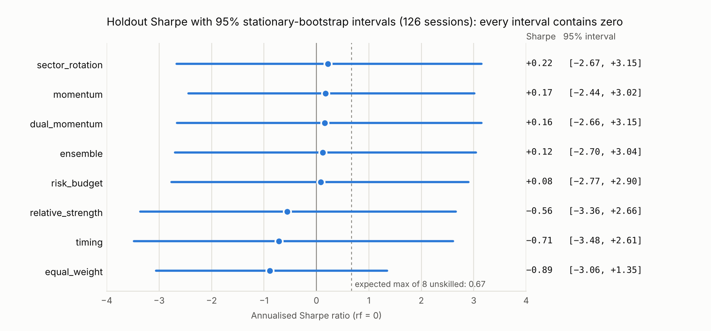
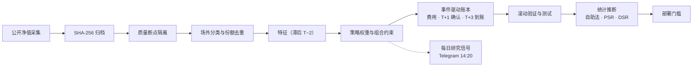

<div align="center">

<h1>FuGuoCup Quant</h1>

<p><b>富国场外基金的行业动量：扣除申赎成本与结算时滞后的样本外检验</b></p>

<p>
  <a href="https://github.com/stevia7896/FuGuoCup-quantsys/actions/workflows/ci.yml"></a>
  
  
  
  
</p>

<p>个人研究项目 · <a href="README.en.md">English</a></p>

<p><a href="#摘要">摘要</a> · <a href="#方法">方法</a> · <a href="#验证设计">验证设计</a> · <a href="#结果">结果</a> · <a href="#统计推断">统计推断</a> · <a href="#工程实现">工程实现</a> · <a href="#复现">复现</a></p>

</div>

> [!NOTE]
> **核心结论：** 9 个预先设定的策略中，没有一个在扣费后表现出稳定的样本外优势。实时信号所用的 `sector_rotation` 在 8 个滚动窗口中只有 3 个为正，最终测试 +1.23%，但测试期内曾先涨到 +26.2%，随后回撤 20.3%。成本与收益同一量级。本项目更可靠的产出是研究基础设施：逐时点的数据质量隔离、显式申赎账本，以及可按哈希复现的结果。

<div align="center">

| 预设策略 | 回测可买入基金 | 样本外窗口 | 通过部署门槛 | 最高 DSR |
|:---:|:---:|:---:|:---:|:---:|
| **9** | **500** | **8 滚动 + 1 测试** | **0** | **0.38** |

</div>

## 摘要

| | |
|---|---|
| 研究问题 | 截面行业动量叠加趋势过滤，扣除申购/赎回费、T+1 确认、T+3 到账和限购后，能否在富国场外基金中产生稳定的风险调整收益？ |
| 样本 | 2021-01-04 → 2026-10-16；回测可买入 500 只基金（来自 917 个目录代码） |
| 验证 | 固定参数，无参数搜索；252 日初始训练 → 8 × 126 日滚动窗口 → 126 日最终测试 |
| 结论 | 不支持"行业动量是稳定 alpha"。所有策略测试期夏普的 95% 自助法区间都跨零，多重比较校正后 DSR ≤0.38。滚动验证与最终测试的符号对多数策略不一致；动量类策略测试期费用占初始资金 2.7%–3.5% |
| 状态 | 研究模式。无策略通过部署门槛；实时信号仅作前瞻纸面记录 |

结果均来自 [`sample_results/2026-10-16/`](sample_results/2026-10-16/)（`model_hash ad4a7a6`、`config_hash 0b02a25`、快照 `sha256 191bb947`）。同一快照重复运行，结果逐位一致。

<picture>
  <source media="(prefers-color-scheme: dark)" srcset="docs/figures/intervals-dark.png">
  
</picture>

<sub>测试期各策略的夏普比率与 95% 自助法区间；虚线为 8 个无技能策略中最大夏普的期望。方法见<a href="#统计推断">统计推断</a>。</sub>

## 研究假设

| 假设 | 检验 | 结果 |
|---|---|---|
| H1：行业层面 20 日动量具有持续性 | 行业平均 `mom20` 取前 2 个行业，行业内选基 | **不支持**。`sector_rotation` 8 个窗口中 3 个为正，单窗口收益 −16.12% 至 +23.99%；滚动期复合收益 −4.38% |
| H2：趋势过滤与风险预算能控制回撤 | `timing` 广度择时；`risk_budget` 相关性筛选 + 逆波动 + 12% 目标波动 | **部分支持**。`risk_budget` 测试回撤 10.44%，动量类为 20%–28%；但其滚动期收益 −10.60% |
| H3：申赎成本与时滞会显著侵蚀信号 | 显式建模申购费、FIFO 赎回费阶梯、最短持有、T+1/T+3 | **支持**。动量类测试期换手 7.9–11.2 倍，费用 5,332–7,049 元，与测试期收益同量级 |

## 数据

| 阶段 | 数量 | 说明 |
|---|---:|---|
| 富国目录代码 | 917 | 公司页自动发现，逐只核验管理人 ID |
| 场外基金 | 808 | 排除场内 ETF、场内货币、REIT 等 |
| 评分截面 | 701 | 采集成功且历史 ≥128 条；96 只历史不足，11 只模型不支持 |
| 回测可买入集合 | 500 | 模型支持（排除 QDII、FOF、货币、持有期/定开等）且历史 ≥252 条 |

- **数据质量**：917 只中有 348 只（38%）存在单位净值与供应商收益之间无法由分红/拆分解释的断点。断点按时点隔离：不回溯删除历史，断点后重新累计历史长度；持仓跨越断点的回测段判为无效，不拼接收益。
- **可审计**：原始响应与派生 CSV 都记录 SHA-256，可从归档的原始响应离线重建快照。
- **份额去重**：A/C 等份额按名称分组，同一底层资产只保留一个份额，避免同一敞口被重复计入。

## 方法

### 特征

所有特征只使用信号日及之前已完成的净值（信号滞后 T−2）。

<details>
<summary><b>特征定义（10 个）</b></summary>

| 特征 | 定义 |
|---|---|
| `mom20/60/126` | `P_t / P_{t−n} − 1` |
| `vol20/60` | 日收益标准差 × √252 |
| `trend` | `P_t / mean(P_{t−119..t}) − 1` |
| `drawdown60` | `P_t / max(P_{t−59..t}) − 1` |
| `risk_adjusted` | `mom60 / max(vol60, 0.01)` |
| `multi_momentum` | 0.25·`mom20` + 0.35·`mom60` + 0.40·`mom126` |
| `score` | 30% rank(`mom20`) + 30% rank(`mom60`) + 20% rank(`risk_adjusted`) + 20% rank(−`vol60`) |

</details>

### 策略

除 `equal_weight` 外，所有策略先剔除 `drawdown60 ≤ −20%` 的基金，至多持有 3 只。标注"广度缩放"的策略按权益基金中 `trend>0 且 mom60>0` 的占比判断市场状态：risk_on（≥60%）、mixed（≥35%）、risk_off，总仓位分别乘以 1.0、0.75、0.5。

<details>
<summary><b>9 个策略的规则</b></summary>

| 策略 | 规则 |
|---|---|
| `cash` | 全现金 |
| `equal_weight` | 全部可买入基金等权；预设的比较基准 |
| `momentum` | `mom60>0`，按 `mom60` 排序；广度缩放 |
| `relative_strength` | `mom20>0`，按 `risk_adjusted` 排序；广度缩放 |
| `sector_rotation` | 行业平均 `mom20` 为正的前 2 个行业，行业内 `mom60>0`，按 `score` 排序；广度缩放 |
| `timing` | `trend>0 且 mom60>0`，按 `score` 排序；广度 ≥60% 满仓，≥35% 用 40% 仓位，否则空仓 |
| `dual_momentum` | 权益类 `multi_momentum>0`、`trend>0`、`drawdown60>−15%`；risk_off 或无候选时转向 `mom60>0` 的债基；广度缩放 |
| `risk_budget` | `dual_momentum` 的候选 + 60 日相关性 <0.85 筛选 + 逆波动加权，目标年化波动 12% |
| `ensemble` | `momentum`、`dual_momentum`、`risk_budget` 三者权重的平均 |

</details>

**组合约束**：单基金 ≤35%、单行业 ≤50%、总仓位 ≤95%，在权重投影阶段执行，而非事后裁剪。

### 执行与成本

自建事件驱动账本，逐日记录现金、逐批份额、应收款和在途申赎；不使用第三方回测框架，不加杠杆。

<details>
<summary><b>执行与成本假设</b></summary>

| 项目 | 假设 |
|---|---|
| 时序 | T−2 信号 → T 日提交 → T+1 确认 → 赎回 T+3 到账；未到账赎回款不可再用于申购 |
| 申购费 | 0.15%，外扣法 |
| 赎回费 | 按 FIFO 批次和持有天数：<7 日 1.5%，<365 日 0.5%；未满 7 日不可赎回 |
| 再平衡 | 每周首个交易日 |
| 缺失数据 | 净值缺失、无净值成交、质量断点按段记为错误；不用 0 收益或拼接收益填充 |

</details>

费率为研究假设，并非逐只核验的真实费率；正式模式要求逐只填写并注明来源。

## 验证设计

- **切分**：前 252 个观测为初始训练；随后 8 个不重叠的 126 日滚动窗口（2022-01-17 → 2026-03-19）；最后 126 个观测（2026-04-10 → 2026-10-16）为最终测试。
- **连续账本**：持仓、费用、确认和到账在窗口之间连续滚动，不在每个窗口重置现金。
- **固定参数**：9 个策略在查看结果前全部预先设定，不做参数搜索，也不根据测试结果改选赢家。
- **部署门槛**：相对 `equal_weight` 的窗口超额收益，均值的近似 95% 下界须 >0；滚动期与测试期收益均须为正；测试期须跑赢基准，且回撤 ≤30%。
- **已知偏差**：最终测试区间已被查看过，不再是未见样本；9 个策略 × 8 个窗口存在多重比较问题，因此单窗口超额不作为显著性证据。晋级必须依赖前瞻记录。

**指标口径**：滚动期收益为 8 个窗口在连续账本上的复合收益；年化按 252 日；夏普以日收益计算，无风险利率取 0；换手为测试期双边成交额 ÷ 平均资产；最大回撤取测试期内的峰谷。

## 结果

| 策略 | 滚动期收益 | 正收益窗口 | 测试收益 | 测试年化 | 最大回撤 | 夏普 | 换手 | 费用（元） |
|---|---:|---:|---:|---:|---:|---:|---:|---:|
| `cash` | 0.00% | 0/8 | 0.00% | 0.00% | 0.00% | 0.00 | 0.00 | 0 |
| `equal_weight` | 无法验证 | — | −7.87% | −15.13% | 14.04% | −0.89 | 1.21 | 468 |
| `momentum` | 无法验证 | — | +0.13% | +0.25% | 27.91% | 0.17 | 8.48 | 5,876 |
| `relative_strength` | 无法验证 | — | −7.10% | −13.69% | 21.72% | −0.56 | 11.18 | 7,049 |
| **`sector_rotation`** | **−4.38%** | 3/8 | **+1.23%** | +2.47% | 20.33% | 0.22 | 9.20 | 6,357 |
| `timing` | +21.79% | 3/8 | −7.90% | −15.17% | 21.01% | −0.71 | 9.23 | 5,941 |
| `dual_momentum` | +1.00% | 3/8 | +0.20% | +0.40% | 24.47% | 0.16 | 8.43 | 5,718 |
| `risk_budget` | −10.60% | 1/8 | +0.15% | +0.30% | 10.44% | 0.08 | 5.42 | 3,513 |
| `ensemble` | 无法验证 | — | −0.03% | −0.06% | 21.58% | 0.12 | 7.90 | 5,332 |

初始资金 200,000 元，扣费后。"无法验证"：持仓在 2022-04-06 跨越无法解释的净值断点，该段回测无效。

<picture>
  <source media="(prefers-color-scheme: dark)" srcset="docs/figures/holdout-dark.png">
  
</picture>

**发现**

1. **没有稳健的样本外优势。** 只有 `dual_momentum` 在滚动期和测试期同时为正（+1.00% / +0.20%）。`timing`（+21.79% / −7.90%）、`risk_budget`（−10.60% / +0.15%）、`sector_rotation`（−4.38% / +1.23%）两个阶段符号相反。
2. **测试期由一次行情主导。** 三个动量策略都在 2026-06-25 见顶（`sector_rotation` +26.2%、`dual_momentum` +32.3%、`timing` +14.9%），7 月转入 risk_off 后几乎全部回吐，回撤 20%–24%。
3. **成本与收益同量级。** 动量类策略测试期换手 7.9–11.2 倍，费用占初始资金 2.7%–3.5%。
4. **部署门槛无法计算。** 基准 `equal_weight` 跨越净值断点，窗口超额检验不成立，没有策略晋级。
5. **结果随基金池漂移。** 早期基金池（[`sample_results/review/`](sample_results/review/)）下 `sector_rotation` 为 −2.47% / +1.20%。

### 统计推断

在冻结的测试期日收益上计算，固定种子（[`robustness.md`](sample_results/2026-10-16/robustness.md)）。

| 策略 | 夏普 | 夏普 95% CI | 年化超额 | 超额 95% CI | PSR | DSR |
|---|---:|---:|---:|---:|---:|---:|
| `equal_weight` | −0.89 | [−3.06, 1.35] | — | — | 0.26 | 0.13 |
| `momentum` | 0.17 | [−2.44, 3.02] | +20.7% | [−55.7%, +90.0%] | 0.55 | 0.36 |
| `relative_strength` | −0.56 | [−3.36, 2.66] | +2.7% | [−56.2%, +58.4%] | 0.35 | 0.19 |
| **`sector_rotation`** | 0.22 | [−2.67, 3.15] | +19.8% | [−30.7%, +66.7%] | 0.56 | 0.38 |
| `timing` | −0.71 | [−3.48, 2.61] | +0.6% | [−58.2%, +52.4%] | 0.31 | 0.16 |
| `dual_momentum` | 0.16 | [−2.66, 3.15] | +19.7% | [−55.7%, +83.8%] | 0.54 | 0.36 |
| `risk_budget` | 0.08 | [−2.77, 2.90] | +15.9% | [−17.3%, +49.5%] | 0.52 | 0.34 |
| `ensemble` | 0.12 | [−2.70, 3.04] | +17.9% | [−41.1%, +70.1%] | 0.53 | 0.35 |

<details>
<summary><b>方法</b></summary>

- **区间**：平稳自助法（Politis–Romano），10,000 次重采样，平均块长 10 个交易日；块长取 5、10、20 日结论不变。超额相对 `equal_weight`，策略与基准用同一组重采样下标（配对）。
- **PSR**：真实夏普 >0 的概率，按样本长度、偏度和峰度修正（Bailey & López de Prado, 2012）。
- **DSR**：门槛取 8 个无技能策略中最大夏普的期望（0.67），校正多重比较（Bailey & López de Prado, 2014）。按日收益平均相关性折算，有效试验数为 2.0。

</details>

1. **夏普区间全部跨零。** 126 个交易日下 95% 区间约 ±2.9；`sector_rotation` 的 0.22 与 0 无法区分（PSR 0.56）。
2. **相对基准的超额不显著。** 五个策略的年化超额点估计为 +16% 至 +21%，区间从 [−17%, +50%] 到 [−56%, +90%]，全部包含 0；点估计主要来自基准自身下跌 7.87%。
3. **多重比较后更弱。** 最高 DSR 为 0.38；最高夏普 0.22 低于 8 个无技能策略最大夏普的期望 0.67。
4. **滚动窗口一致。** 可验证的 4 个策略在 8 个窗口中分别有 3、3、3、1 个为正，单侧符号检验 p ≥ 0.86。

## 前瞻纸面记录

每个 A 股交易日 14:20，系统通过 Telegram 推送 `sector_rotation` 的研究信号，作为后续晋级评估的前瞻样本。

**截至 2026-11-10 尚无记录。** GitHub 原生 cron 在本仓库延迟 5–10 小时，10-19 至 11-10 的 17 个交易日没有信号在 14:20–14:55 窗口内送达；系统不补发过时信号。11-11 起改为窗口前 14 小时内每 20 分钟触发一次，效果待验证。设计见 [调度设计](docs/scheduling.md)。

## 工程实现

- 每次研究运行写入 manifest：配置哈希、源码哈希、时间窗。
- 129 个回归测试，覆盖前视偏差、费用与结算、数据断点、统计推断、通知去重与调度状态；CI 跑 Python 3.11 / 3.12 / 3.13 和一个真实数据 smoke test。
- 发送前先持久化预约，同一信号不会重复发送。



<details>
<summary><b>模块</b></summary>

```text
src/fullgoal_quant/
  data.py        采集、解析、归档与 SHA-256
  universe.py    场外分类、份额组与管理人核验
  signals.py     特征、策略与组合约束
  backtest.py    事件驱动账本：费用、确认、到账
  research.py    固定方案滚动验证与 manifest
  inference.py   平稳自助法、PSR / DSR、符号检验
  portfolio.py   实际账户与调仓提案
  report.py      报告与每日信号文本
  calendar.py    官方交易日历
  notifications.py / runstatus.py   发送预约、去重与运行状态
```

</details>

## 局限

- **幸存者偏差**：候选池只含现存基金，没有退市基金。
- **数据时点**：净值是供应商事后修订版，T−2 滞后只是发布延迟的代理。
- **成本**：费率、确认/到账日和限购为统一假设，未逐只核验；滑点为 0。
- **样本**：测试期 126 日，只含一次行情。

## 下一步

- **验证**：在前瞻记录上重做自助法区间与 DSR；修复基准的净值断点后计算窗口超额区间。
- **数据**：point-in-time 基金池与退市基金；净值发布时点。
- **信号**：拆分行业选择与基金选择的贡献；动量窗口的稳健性。
- **成本**：日度 vs 周度再平衡的净成本；用平台流水校准费率。

## 复现

```bash
python3 -m venv .venv && source .venv/bin/activate
python -m pip install .
python -m unittest discover -s tests -b

fq collect                  # 采集公开数据（data/ 不入库）
fq research --out reports/research
python scripts/robustness.py sample_results/2026-10-16   # 统计推断，固定种子
pip install matplotlib && python scripts/plot_holdout.py sample_results/2026-10-16 docs/figures
python scripts/plot_intervals.py sample_results/2026-10-16 docs/figures
```

`data/` 不入库。在同一快照（[`provenance.json`](sample_results/2026-10-16/provenance.json)）上结果逐位一致；重新采集会因净值修订和基金池变化而不同。

---

<sub>[研究方法](docs/METHODOLOGY.md) · [运维手册](docs/OPERATIONS.md) · [调度设计](docs/scheduling.md) · [部署与验收](docs/DEPLOYMENT.md) · [审查记录](docs/REVIEW.md)　|　个人研究项目，不构成投资建议。</sub>
